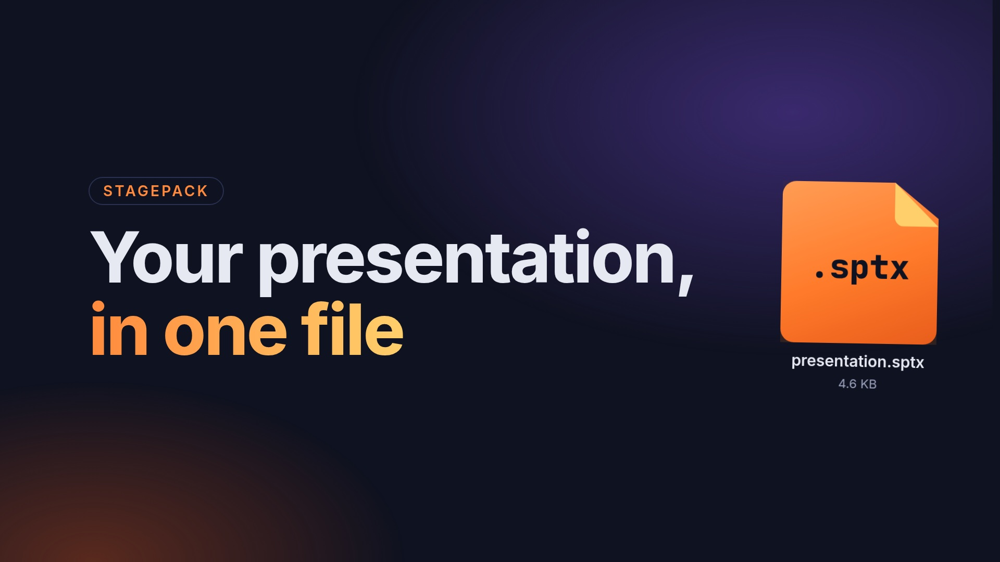
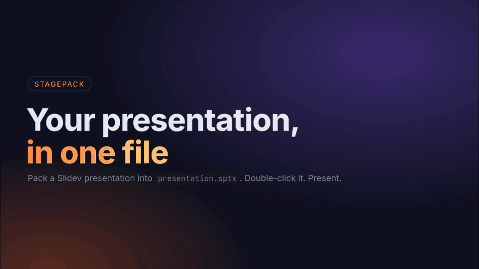
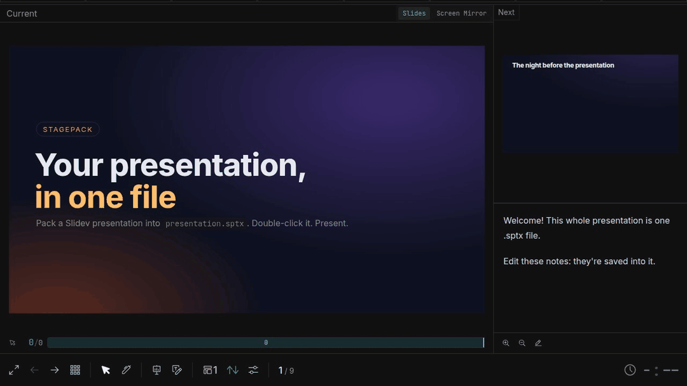
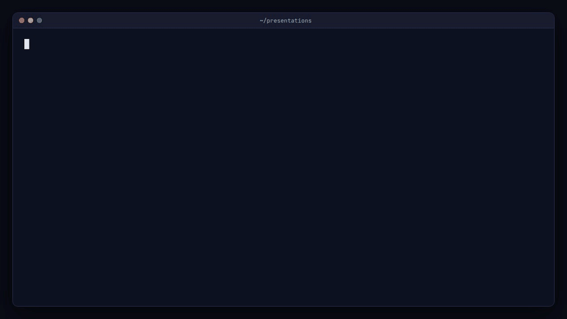

# Stagepack

[](assets/readme/launch.mp4)

Stagepack packs a [Slidev](https://sli.dev) presentation into one file, `presentation.sptx`, that opens with a double-click.
The viewer brings its own Node and a pinned Slidev, so the presenter needs nothing installed: no Node, no npm.
It works offline when the presentation bundles its fonts (see "Fonts" below). The presentation opens in Slidev's presenter
view, and edits to the speaker notes are saved back into the `.sptx` file.

A presentation can carry its own code (a Vite config, `setup/` files, Vue components, bundled packages), and Slidev
runs that code as you, like opening any Slidev project. So before it shows such a presentation, the viewer asks, once
for each version of the presentation, like Office does for macros. Presentations of only slides, styles, pictures and fonts
open without asking.



Status: the packer, the viewer and the per-user install (file type, tray icon, dialogs) work on Linux
(tested on Ubuntu with GNOME). The Windows installer is built and tested as far as cross-compiling and unit
tests go, but see "Open items" below.

## Install

Every channel installs the same build for the current user only, with no administrator rights or sudo,
and registers `.sptx` files so they open with a double-click. Releases are at
[github.com/Eiriksb/stagepack/releases](https://github.com/Eiriksb/stagepack/releases).

**Windows:** download `Stagepack-Setup.exe` from the latest release and run it (see "For presenters" below,
also about the "Windows protected your PC" warning).

**Linux (x86_64), one line:**

```bash
curl -fsSL https://raw.githubusercontent.com/Eiriksb/stagepack/main/install.sh | sh
```

[`install.sh`](install.sh) downloads `stagepack-<version>-linux-x64.tar.xz` (about 120 MB) from the latest
release and checks it against the release's `SHA256SUMS`. It unpacks it under `~/.cache` and runs
`stagepack install --yes` from there, which copies it to `~/.local/share/stagepack`. It needs `tar`, `xz`,
`sha256sum` and `curl` or `wget`. `STAGEPACK_VERSION=0.1.0` picks a given release. Arguments go on to
`stagepack install`: `curl … | sh -s -- --home DIR`. The checksum guards against a broken download. It comes
from the same place as the tarball, so it doesn't replace trusting GitHub; to check by hand, use the
tarball below.

**npm (Linux x86_64 or Windows x64):**

```bash
npx stagepack install
```

or `npm install -g stagepack`, then `stagepack install`. The npm package is a small launcher, not the 800 MB
viewer. `stagepack install` downloads the release of the same version for your platform and checks it against
the SHA-256 checksums published inside the npm package. Then it runs that build's own installer: the Linux
tarball's `stagepack install`, or `Stagepack-Setup.exe`. Afterwards `stagepack open|pack|uninstall` run the
installed viewer. Uninstalling the npm package leaves the viewer in place: run `stagepack uninstall` first.

**By hand (Linux):** download the tarball and `SHA256SUMS` from the release, then:

```bash
sha256sum --ignore-missing -c SHA256SUMS
```

```bash
tar -xJf stagepack-0.1.0-linux-x64.tar.xz
```

```bash
stagepack-0.1.0-linux-x64/stagepack install
```

The unpacked folder can be deleted afterwards. To update, install the new version the same way; a presentation
must not be open meanwhile. `~/.local/share/stagepack/stagepack version` prints the installed version. To
remove it, see "On Linux" below.

## For presenters

You get two files: `Stagepack-Setup.exe` (the same one for every presentation) and the presentation, a `.sptx` file. The
same text is in `PRESENTER.txt`, which `make build-windows` puts next to the installer.

1. **Download both files first.** Don't open the presentation from the email or from the Teams preview: save both
   files to a folder, then work from there.
2. **Run `Stagepack-Setup.exe` once.** Double-click it and answer Yes; it needs no administrator rights. On
   "Windows protected your PC", click **More info**, then **Run anyway**. The installer is not signed with
   a purchased certificate, so Windows doesn't know it yet.
3. **Double-click the `.sptx` file.** The first start can take a moment; "Opening …" is shown meanwhile.
   The presenter view then opens in a window of its own, with the speaker notes. To show the slides to the
   audience, click the screen icon in the presenter view, or use the Stagepack tray icon (bottom right, next
   to the clock; it may be under the small arrow) and choose **Open audience view**. Drag that window to the
   projector.
4. **Notes are saved into the file.** Edit the speaker notes as you like; they are written into the `.sptx`
   file. Hover over or click the tray icon to see "Notes saved".
5. **To finish, use the tray icon and choose Stop, or close the presentation's windows.** The notes are saved one
   last time and the presentation closes.



**The presentation's windows** are app windows of Chrome, Edge, Chromium or Brave, whichever is installed (Edge
always is on Windows): no tabs, no address bar, and a browser profile of their own, apart from yours. Stop
closes them, and closing all of them stops the presentation. Where none of those browsers is installed (or only as a
snap, whose confinement keeps it out of the profile folder), the presentation opens in your default browser instead,
and only Stop ends it. `stagepack open --default-browser FILE` asks for the default browser.

**Save a copy…** in the tray menu saves the presentation, with your notes, under another name; notes you edit after
that go into the copy. Use it when the tray says **Notes not saved in the file**: the `.sptx` file could not
be written (it is read-only, or the USB stick was removed). Your notes are kept meanwhile, and Save a copy
puts them in a new file. **Temporary copy** means the presentation was opened from an email or a preview, so notes
would be lost with it: Save a copy keeps them.

If you open the same file twice, the second launch brings up the running presentation instead of starting another.
The viewer connects only to `127.0.0.1`. The file is replaced atomically when notes are saved, so a crash leaves
the old or the new file, never a broken one.

**"… contains code"**: some presentations come with code of their own (for example an interactive component), which
runs on your computer, with access to your files, while the presentation is shown. Before it starts such a presentation,
Stagepack lists what the code is and asks. Choose **Yes** only if you trust the person who sent you the file;
it then remembers your answer for this version of the presentation, so you aren't asked again when you reopen it
(notes you edit don't count as a change). **No** closes it without running anything. If the presentation is changed
later, you are asked again. Presentations without code never ask.

To remove Stagepack: **Settings → Apps → Stagepack → Uninstall**. Your `.sptx` files are not touched.

### On Linux

There is no setup program: the Linux build (the release tarball, or `make build-linux`: a folder with
`stagepack`, `node/` and `runtimes/` in it) installs itself for the current user, without sudo. The install
script and the npm package (see "Install" above) do step 1 for you.

1. **Install once:** run `stagepack install` from that folder, in a terminal (`--yes` skips the question). It copies
   the viewer, Node and the Slidev runtime to `~/.local/share/stagepack` (`$XDG_DATA_HOME/stagepack`) and
   registers `.sptx` files as their own type, `application/x-stagepack`, opened by Stagepack, so the file
   manager no longer treats them as zip files.
2. **Double-click the `.sptx` file**, as on Windows. "Opening …" is shown meanwhile, then the presenter view
   opens in its own window (see "The presentation's windows" above).
3. **The tray icon** (top right on Ubuntu) has the same menu as on Windows: the notes status, **Open
   presenter**, **Open audience view**, **Save a copy…** and **Stop**. Ubuntu shows tray icons out of the box;
   on other GNOME desktops turn on the AppIndicator extension. Where no tray is shown, a small window with the
   same buttons stands in for it; closing that window stops the presentation.
4. **Dialogs** (errors, "Save a copy…", and the "… contains code" question) are shown with `zenity`, or
   `kdialog` on KDE. Without either, messages go to the log and to a desktop notification, and the code
   question is answered No: such a presentation does not open until zenity is installed.
5. **To remove it:** `~/.local/share/stagepack/stagepack uninstall`. It removes exactly what the install
   added (the folder, the MIME type, the desktop entry, the icons and the default-application entry) and, as on
   Windows, keeps notes that are not yet in any presentation. Your `.sptx` files are not touched.

## For authors

Make a normal Slidev project (a folder with `slides.md`), then:

```
stagepack pack DIR -o presentation.sptx
```



Options:

| flag | meaning |
|---|---|
| `-o OUT` | the `.sptx` file to write |
| `--entry slides.md` | the slides file, relative to `DIR` |
| `--title T` | presentation title (default: the headmatter title, else the folder name) |
| `--exclude PREFIX` | leave out a path prefix (whole path components), repeatable; nothing there is read, so a link there may lead nowhere |
| `--only-used-public` | pack only the files in `public/` the presentation names by path (see below) |
| `--meta k=v` | free-form manifest metadata, repeatable |

Packing leaves out of the file whatever the pinned runtime already provides (Slidev itself, its default theme,
the Inter and JetBrains Mono fonts), so a presentation without extra dependencies is just your slides and media. Other
`node_modules` your presentation needs are included. If the presentation has no local favicon, a bundled one
(`public/stagepack-favicon.svg`) is added so the viewer makes no network request. Your folder is never modified.

`--only-used-public` is for a folder whose `public/` holds more than this presentation uses, such as two
presentations sharing one folder. A file in `public/` goes in only when the presentation names its path
(`/clips/intro.mp4` for `public/clips/intro.mp4`, also written with `%20` for a space): in the slides file, in a
slides file it imports with `src:`, in its components, styles and config, or in a page in `public/` that is
itself kept. Other markdown in the folder, such as another presentation's slides or a README, does not count.
A path the slides put together at run time (`'/clips/' + name`) can't be seen, so pack lists every file it
left out: check that none of them is needed.

`stagepack open presentation.sptx` does what a double-click does.

### Export from Slidev (the addon)

[`slidev-addon-stagepack`](addon/) adds an **Export as .sptx** button (a box icon) to Slidev's nav bar, in play
mode and in the presenter's toolbar. It is there only while you run `slidev` (the dev server). One click runs
`stagepack pack` on the presentation and the browser downloads the `.sptx` file; pack's notes (fonts, code) are shown
next to the button. It packs with the installed Stagepack, so install that first (see "Install").

```bash
npm i -D slidev-addon-stagepack
```

Then name it in the headmatter of `slides.md`, as `addons: [stagepack]` on one line, or `addons:` with
`  - stagepack` on the next. The viewer's runtime bundles its own copy of the addon, where it does nothing, so a
presentation that names it opens there without the "contains code" question. That holds for exactly this addon
(`stagepack` or `slidev-addon-stagepack`); any other addon still counts. `stagepack pack` never bundles your copy
of it. Details are in [addon/README.md](addon/README.md).

### Code in a presentation

The viewer asks the presenter before it shows a presentation that contains code (see "For presenters"), and
`stagepack pack` prints a note naming each thing that makes it so. These count:

- files named `vite.config*`, `uno.config*`, `unocss.config*`, `postcss.config*` or `.postcssrc*`;
- anything under `setup/`;
- an `index.html` next to the slides file: Slidev puts its head and body into the page, scripts and all;
- any `.vue`, `.js`, `.mjs`, `.cjs`, `.ts`, `.mts`, `.cts`, `.jsx`, `.tsx`, `.node` or `.wasm` file, also in
  `public/`;
- a bundled package that holds such a file, or whose `package.json` lists Slidev addons (other packages of only CSS
  and fonts, like Fontsource, don't count);
- any theme but the one the runtime bundles, and any addon but the export addon the runtime bundles
  (`stagepack`, `slidev-addon-stagepack`; see above);
- the `pwa` option set to anything but `false`: Slidev then loads `vite-plugin-pwa`, which isn't in the runtime,
  from the presentation's folder or else from the presenter's own global packages;
- a bundled package with `stagepack` in its name, whatever it holds: Slidev would find it instead of the
  runtime's export addon;
- a bundled package, whatever it holds, with the name of a package the runtime has (`@slidev/theme-default`,
  `@slidev/client`, `vue`, the runtime's fonts and the rest), or of one Slidev tries for the bundled theme
  (`slidev-theme-default`, `default`), or of one Slidev or Vite loads from the presentation's folder (`vite-plugin-pwa`,
  `playwright-chromium`, and the CSS preprocessors `sass-embedded`, `sass`, `sugarss`, `less`, `stylus`).
  Slidev and Vite look in the presentation's `node_modules` first, so the presentation's copy would be used: a theme's
  `index.html`, scripts and all, goes into the page, and Node runs a package's entry file whatever its
  extension. `stagepack pack` never bundles a package the runtime has;
- `"slidev": {"addons": [...]}` listing any other addon, or a `"postcss"` key, in any `package.json`, or a
  `package.json` that isn't valid JSON.

Slidev reads the theme, addons and `pwa` from the headmatter with a full YAML parser, and YAML has many ways to
write a key or carry a value over lines. So the viewer doesn't guess: before it asks, it runs Slidev's own
parser (the runtime's `@slidev/parser`, with the bundled Node, on the unpacked slides file only) and judges what
that returns. Nothing from the presentation runs for this. The only theme that needs no question is the bundled one
(`default`, `none` or `@slidev/theme-default`), and the only addon is the bundled export addon. Any other theme
and any other addon count, and so does `pwa` unless it is `false`, also when set under `config:`, and so does a
headmatter that can't be read. A changed theme, addon list or `pwa` value asks again.

`stagepack pack` has no Node of its own, so its note uses a rougher check: it allows only `theme: default` on
its own line in the `---` block at the top of the slides file (and `pwa: false` the same way), and names any
other `theme:`, `addons:` or `pwa:` line, in code blocks and slide text too. The viewer may not ask about all of
those. File names are compared ignoring case, as Windows finds them.

The answer is remembered per presentation (its id) and version: a hash of every file in it except the slides file, which
note edits change, and of the reasons it contains code (so of its theme, addons and `pwa`). Any other change,
repacking included, asks again. The list is `trusted.json` in the
viewer's home. Where nobody can be asked (`stagepack open --headless`, and on Linux without `zenity` or
`kdialog`), the answer is No; `stagepack open --trust-code FILE` runs a presentation you trust without asking, and does not add it
to the list.

### Fonts

Slidev's default font provider is Google Fonts: the browser loads the presentation's fonts from the internet when it
is shown, so without a network the slides fall back to other fonts. To make a presentation work offline, bundle its
fonts:

1. Install a [Fontsource](https://fontsource.org) package per font, for example
   `npm i @fontsource-variable/roboto`, and import it in the presentation's `style.css`:
   `@import '@fontsource-variable/roboto';`. Inter and JetBrains Mono (`@fontsource-variable/inter`,
   `@fontsource-variable/jetbrains-mono`) are in the viewer's runtime already: import them, no install needed.
2. Set the provider to `none` in the headmatter of `slides.md`:

   ```yaml
   fonts:
     sans: Roboto Variable
     mono: JetBrains Mono Variable
     provider: none
   ```

`stagepack pack` warns when the headmatter does not set `provider: none`; it does not change the presentation.

## Building from source

Needs a Linux (amd64) build host with `curl`, `tar`, `unzip` and `npm`. Go and Node are downloaded once into
`.cache/`, pinned and checksummed (`build/versions.env`, `build/fetch.sh`).

| target | what it does |
|---|---|
| `make test` | gofmt check, `go vet`, unit tests |
| `make e2e` | end-to-end tests against the Linux build in `dist/linux` (skipped when it is missing) |
| `make node OS=linux` | puts Node in `dist/linux/node/` (`OS=win32` for Windows) |
| `make runtime OS=linux` | installs the pinned Slidev runtime in `dist/linux/runtimes/53/` and checks its licences (online) |
| `make build OS=linux` | builds `dist/linux/stagepack` (`OS=win32` cross-compiles `stagepack.exe`) |
| `make build-linux` | `dist/linux/stagepack` with `node/` and `runtimes/` beside it; fetches Node and installs the runtime only if they are missing |
| `make build-windows` | `dist/windows/Stagepack-Setup.exe` and `PRESENTER.txt` beside it; the same for Windows (Node, runtime, viewer, payload, installer) |
| `make licenses-go` | the licences of the Go modules the Linux and Windows programs link (`build/go-licenses.tsv`); fails on a module that isn't permissive or isn't in the table |
| `make setup` | builds `dist/windows/Stagepack-Setup.exe`: the installer, with the Node and Slidev runtime and the viewer inside (needs `make node runtime OS=win32`; fetches go-winres, 0BSD, once for the icon) |

| `make release VERSION=0.1.0` | `make test licenses-go`, then both builds with the version stamped in, packed into `dist/release/v0.1.0/` (below) |
| `make gh-release VERSION=0.1.0` | publishes `dist/release/v0.1.0/` as the GitHub release `v0.1.0` (online) |

For a Windows check without Windows: `GOOS=windows go vet ./...` and `GOOS=windows go build ./cmd/stagepack`.

### Releasing

`VERSION` (like `0.1.0`, no `v`) is stamped into both programs: `stagepack version` prints it, and on Windows
it is in the file's version info and in the Settings → Apps entry. Builds without it say `dev`.

1. Commit everything. `make release VERSION=0.1.0` refuses uncommitted changes (`ALLOW_DIRTY=1` makes a trial
   build anyway) and a tag `v0.1.0` that is not the current commit. It runs `make test licenses-go`, builds
   `dist/linux` and `dist/windows`, and writes `dist/release/v0.1.0/` (`build/release.sh`):

   | file | what |
   |---|---|
   | `Stagepack-Setup.exe`, `PRESENTER.txt` | the Windows installer and the presenter's guide |
   | `stagepack-0.1.0-linux-x64.tar.xz` | `dist/linux` (the program, `node/`, `runtimes/`, without the viewer's own state) and `LICENSE`, in one folder |
   | `SHA256SUMS` | of the three above |
   | `RELEASE_NOTES.md` | the text of the GitHub release |
   | `npm/stagepack-0.1.0.tgz` | the npm launcher (`npm/`), with this version and `SHA256SUMS` inside |
   | `npm/slidev-addon-stagepack-0.1.0.tgz` | the Slidev export addon (`addon/`), with this version |

   Node and the runtime are reused from `dist/` when they are there (they are pinned by
   `build/versions.env` and `runtime/package-lock.json`); `make node runtime OS=linux` (and `OS=win32`) makes
   them again. The tarball is the same bytes for the same `dist/linux` and commit. `PRERELEASE=1` adds a
   pre-release note to `RELEASE_NOTES.md`, but not GitHub's pre-release flag: `releases/latest`, which the
   install script and the download link use, skips pre-releases.
2. Push the commit, then `make gh-release VERSION=0.1.0`. It checks
   the files against `SHA256SUMS` and runs `gh release create v0.1.0`, which tags the commit on GitHub. The
   install script uses the latest release, and `releases/latest/download/Stagepack-Setup.exe` always links
   to the latest installer.
3. Publish the npm packages, logged in as their owner (`npm login`): `npm publish
   dist/release/v0.1.0/npm/stagepack-0.1.0.tgz` and `npm publish
   dist/release/v0.1.0/npm/slidev-addon-stagepack-0.1.0.tgz`. The launcher downloads from the GitHub release
   `v0.1.0`, so publish it only after step 2.

To use the Linux build on this machine: `make build-linux`, then `dist/linux/stagepack install` (see "On Linux"
above). Run it again after a new build to update the installed copy; a presentation must not be open meanwhile.

## Layout

The viewer's home (on Windows `%LOCALAPPDATA%\Stagepack\`, on Linux `~/.local/share/stagepack/`) holds:

```
stagepack.exe                                     the viewer (Windows; on Linux the stagepack program)
.stagepack-install                                install marker: uninstall deletes only a folder with it
node/node[.exe]                                   Node 24 (build/versions.env)
runtimes/53/package.json, package-lock.json       the pinned runtime (runtime/)
runtimes/53/pnpm-workspace.yaml                   marks runtimes/53/ as Vite's workspace root
runtimes/53/node_modules/@slidev/cli/bin/slidev.mjs
runtimes/53/node_modules/slidev-addon-stagepack/  the export addon (addon/, copied in by build/addon.sh), inert here
runtimes/53/work/<id>/                            one opened presentation, unpacked
journal/<key>.json                                note edits not yet in the .sptx file (kept by uninstall)
trusted.json                                      presentations allowed to run their code: id and hash of that version
logs/viewer.log                                   the viewer's log (viewer.log.1: the previous one)
logs/<key>.log                                    Slidev's output for one presentation
browser/<hash>/                                   the browser profile of an open presentation's windows (removed when they close)
instances/<hash>.json, .lock                      one running presentation: process, port, URL
```

On Linux the install also writes, below `~/.local/share` (`$XDG_DATA_HOME`), and nothing else:

```
mime/packages/stagepack.xml                       application/x-stagepack: *.sptx, a subclass of application/zip
applications/stagepack.desktop                    Exec=<home>/stagepack open %f, hidden from the app menu
icons/hicolor/{256x256,48x48,32x32,16x16}/apps/stagepack.png   the icon (from assets/stagepack.ico)
```

and runs `update-mime-database`, `update-desktop-database` and `xdg-mime default stagepack.desktop
application/x-stagepack` (which writes `~/.config/mimeapps.list`). The names come from `internal/brand`.

A `.sptx` file is a zip. At its root is `stagepack.json`, the manifest (format version, id, title, created and
updated times, Slidev version, entry file, metadata), next to the presentation's own files (`slides.md`, `public/`, ...).

A presentation is unpacked to `runtimes/53/work/<id>/` and Slidev is started there
(`node runtimes/53/node_modules/@slidev/cli/bin/slidev.mjs ./slides.md --port N --open false`). Slidev, the
theme and the fonts resolve by Node's normal parent lookup to `runtimes/53/node_modules`; no symlink, junction
or generated `vite.config.ts` is needed. Because `runtimes/53/` has `pnpm-workspace.yaml`, Vite's
`server.fs.allow` covers the whole of `runtimes/53/`, so the font files are served (200, not 403). A
`node_modules` symlink in the presentation folder pointing outside it does **not** work: Vite answers the font woff2
files with 403 because they are outside `server.fs.allow`.

Slidev writes its generated files to `work/<id>/node_modules/.slidev/`, so the work folder must be writable
and gets a `node_modules/` even when the presentation vendors nothing.

The Go code is in `cmd/stagepack` (command line) and `internal/` (`brand` holds the product's names; `pack`,
`deck`, `workspace`, `trust`, `save`, `slidev`, `instance`, `ui`, `browser`, `app`).

## Measured

On Linux, a recent laptop, warm disk cache, a presentation with a few hundred MB of video:

| what | time |
|---|---|
| Slidev start to first `200` on `/presenter/` | 0.74-0.86 s (3 runs) |
| `/presenter/` opened to network idle (headless Chrome) | 2.2-2.3 s |
| `npm ci` of the runtime (from npm's cache) | 3 s |

Every slide loads with no 4xx/5xx, the `@fontsource-variable` woff2 files load with 200, and the cover renders
in Inter Variable.

| size | Linux | Windows |
|---|---|---|
| `runtimes/53/node_modules` (685 packages) | 596 MB | 574 MB (27 393 files) |
| `node/` | 208 MB | 110 MB |

## Licences

Stagepack is MIT licensed (see `LICENSE`). It ships only permissively licensed components, plus the
weak-copyleft exceptions below, unmodified.

`build/runtime.sh` runs `build/licenses.mjs`, which writes `runtimes/53/THIRD_PARTY_LICENSES.txt` and fails on
any package outside the permissive list (MIT, ISC, BSD-2/3-Clause, Apache-2.0, 0BSD, OFL-1.1, Unlicense, CC0-1.0,
BlueOak-1.0.0, plus PSF-2.0, Python-2.0, Zlib and CC-BY-4.0). Two packages with no licence field, khroma 2.1.0
and zigpty 0.2.1, are MIT by their licence files; they are pinned by exact version, so a new version fails until
it is checked again. Three are allowed by exception, by exact version: lightningcss 1.33.0 with its platform
binding (MPL-2.0) and elkjs 0.9.3 (EPL-2.0). They are weak, file-level copyleft. Slidev 53 can't do without
them: Vite 8 depends on lightningcss and mermaid on elkjs. They ship unmodified as published on npm and run in
Slidev's own Node process. The build prints them as a warning, and `THIRD_PARTY_LICENSES.txt` lists them in a
separate "Weak-copyleft components (unmodified)" section, with their licence texts and their source: the npm
package, and for the lightningcss platform binding (a compiled binary) the tagged lightningcss repository.

The Go side links only these modules, all permissive. `make licenses-go` builds the Linux and Windows
programs, reads their module lists with `go version -m`, and fails on a module that isn't in
`build/go-licenses.tsv` (so a new dependency has to be reviewed) or whose licence isn't permissive.

| module | version | licence | linked in |
|---|---|---|---|
| `golang.org/x/sys` | v0.49.0 | BSD-3-Clause | Windows |
| `fyne.io/systray` | v1.12.2 | Apache-2.0 | Windows and Linux (the tray icon) |
| `github.com/godbus/dbus/v5` | v5.1.0 | BSD-2-Clause | Linux (systray's D-Bus tray, and the check for a tray area); listed for Windows too |

On Linux no GUI library is linked: the tray speaks D-Bus in pure Go, and dialogs are the `zenity` or
`kdialog` program run as a separate process (both GPL, so they are not linked or shipped).

The npm side is checked by `build/licenses.mjs`, above.

## Open items

- The Windows installer has not yet been run on a real Windows machine. Before the first handover, run
  `Stagepack-Setup.exe` on one and open a `.sptx` file: install, double-click, presenter view, audience view,
  a notes edit saved into the file ("Notes saved"), Stop, uninstall. Until then Windows behaviour is tested
  only by cross-compiling and by the tests that don't need Windows.
