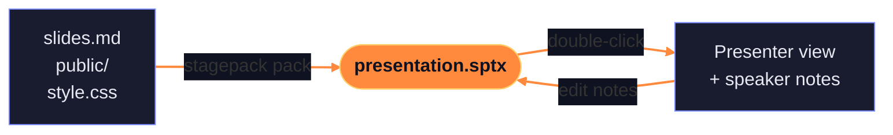

<div class="kicker">Stagepack</div>

# Your presentation,<br><span class="accent">in one file</span>

Pack a Slidev presentation into `presentation.sptx`. Double-click it. Present.

<!--
Welcome! This whole presentation is one .sptx file.

Edit these notes: they're saved into it.
-->

---

# The night before the presentation

<v-clicks>

- "Can you send me the slides?"
- `npm install` on the conference laptop
- 685 packages, no Wi-Fi
- The fonts fall back to Times New Roman
- Your speaker notes live in a Git repo nobody else has

</v-clicks>

<!--
Every Slidev user knows this one. The slides are a web app, and a web app needs Node, npm and the internet.

[click] Somebody asks for the slides.
[click] The presenter's laptop has never seen npm.
[click] And the venue Wi-Fi is down.
[click] Fonts come from Google, so they're gone too.
[click] And the notes? In your repo.
-->

---
layout: center
class: text-center
---

# One file. That's the whole presentation.



<!--
Stagepack zips the presentation: slides, pictures, video, fonts.

The viewer on the other end brings its own Node and a pinned Slidev, so the presenter installs nothing else. And the notes they edit go back into the same file.
-->

---

# For authors: one command

```bash {1|2|3|all}
stagepack pack ./my-presentation -o presentation.sptx
stagepack pack ./my-presentation -o presentation.sptx --title "Q4 kickoff"
stagepack open presentation.sptx
```

<v-click>

<div class="callout">

Slidev, its default theme and the Inter and JetBrains Mono fonts are already in the viewer,
so a presentation is **just your slides and media**.

</div>

</v-click>

<!--
[click] Pack a folder.
[click] Give it a title.
[click] And open it, which is what a double-click does.
[click] Slidev itself isn't in the file, only what's yours.
-->

---
layout: two-cols
layoutClass: gap-10
---

# For presenters

<v-clicks>

1. Run **Stagepack-Setup.exe** once.<br>No admin rights.
2. Double-click **presentation.sptx**.
3. Present. Edit your notes.<br>They're saved **into the file**.
4. Tray icon → **Stop**.

</v-clicks>

::right::

<div class="tray">
  <div class="tray-title">Stagepack</div>
  <div class="tray-row ok">● Notes saved</div>
  <div class="tray-row">Open presenter</div>
  <div class="tray-row">Open audience view</div>
  <div class="tray-row">Save a copy…</div>
  <div class="tray-sep"></div>
  <div class="tray-row">Stop</div>
</div>

<!--
The presenter gets two files: the installer, once, and the presentation.

[click] Setup needs no administrator rights.
[click] Then it's a double-click, like a PowerPoint file.
[click] Notes are written back into the .sptx, atomically, so a crash never leaves a broken file.
[click] And Stop closes everything.
-->

---

# Everything Slidev does, offline

<div class="grid grid-cols-2 gap-8 mt-6">
<div>

Syntax highlighting

```ts {2}
export function pack(dir: string) {
  return zip(dir, { skip: runtime })
}
```

</div>
<div>

Math, rendered locally

$$
\text{size} = \sum_{f \,\in\, \text{presentation}} |f| \;-\; |\text{runtime}|
$$

</div>
</div>

<v-click>

<div class="callout mt-6">
Bundle your fonts with Fontsource and <code>provider: none</code>, and the presentation needs no network at all.
</div>

</v-click>

<!--
Code, math, diagrams, transitions: it's the real Slidev, version 53, so anything your presentation does works here too.

[click] Bundle the fonts and it works on a plane.
-->

---
layout: two-cols
layoutClass: gap-10
---

# Code? It asks first.

Presentations with only slides, styles, pictures and fonts open right away.

A presentation with its **own code** (a Vue component, a Vite config, a theme)
asks once per version, like macros in Office.

::right::

<div class="dialog">
  <div class="dialog-title">“Q4 kickoff” contains code</div>
  <p>It runs on your computer while the presentation is shown:</p>
  <ul>
    <li><code>components/Counter.vue</code></li>
    <li><code>vite.config.ts</code></li>
  </ul>
  <p>Open it only if you trust who sent it.</p>
  <div class="dialog-buttons"><span>No</span><span class="primary">Yes</span></div>
</div>

<!--
Slidev runs a presentation's code as you, so Stagepack asks before it does.

The answer is remembered for that version; editing notes doesn't count as a change, repacking does.
-->

---
layout: fact
---

# 0
Things your presenter has to install<br>besides Stagepack

<!--
No Node, no npm, no Git. Windows and Linux.
-->

---
layout: center
class: end text-center
---

# Double-click. Present.

<div class="end-links">

`npx stagepack install` · github.com/Eiriksb/stagepack

</div>

<!--
Thanks! Questions?
-->
